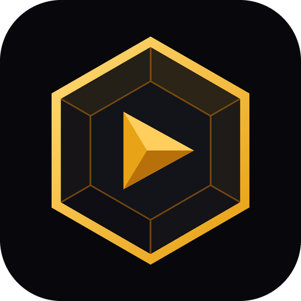

<p align="center">
  
</p>

# GemPlayer

**A video and music player for Ubuntu Touch, modelled on VLC for Android.
Offline by default, no accounts, no tracking.**

GemPlayer plays the videos and music on your phone with VLC's gestures, its
player menu, its library and its play queue. It is built in QML on the media
stack Ubuntu Touch already ships, so it plays what the phone's own players
play, and it adds what they lack: a library with sorting, grouping and
playlists, resume, play-as-audio, bookmarks, A-B repeat, a sleep timer and
subtitles in any of VLC's encodings.

It is built for **Ubuntu Touch** and installed by hand rather than through a
store: see **[docs/INSTALL.md](docs/INSTALL.md)** for the guide.

**Status:** 0.1.0, the first release, after 38 test builds. It is in its
battle test now: a few weeks of daily use on a Pixel 3a, whose findings are
fixed in 0.1.x. Every build is on the
[Releases page](https://github.com/Yenis/ut-media-player/releases); what
each one changed is in [CHANGELOG.md](CHANGELOG.md).

GemPlayer is not VLC and is not affiliated with VideoLAN. It does not contain
libVLC. See [Credits](#credits).

---

## Table of contents

- [Features](#features)
- [What it cannot do](#what-it-cannot-do)
- [Privacy](#privacy)
- [Install](#install)
- [Building from source](#building-from-source)
- [Development](#development)
- [Architecture](#architecture)
- [Documents](#documents)
- [Roadmap](#roadmap)
- [Credits](#credits)
- [License](#license)

---

## Features

| | |
|---|---|
| Video library | The videos on the phone as a grid or a list, with thumbnails, resolution and progress; sorted, filtered, grouped by name or folder, or by groups of your own; favourites |
| Video player | H.264, HEVC, VP9 and AV1, whatever the phone's hardware decodes |
| VLC's gestures | Tap for the controls, double tap to skip or pause, swipe sideways to seek, up and down for volume and brightness, pinch to fill the screen; each can be switched off, and tips show them the first time |
| Picture | Twelve picture sizes, a lock, and the player's own rotation, whatever the system's rotation lock says; rewind and forward buttons if you want them |
| Play as audio | A video carries on as sound with the screen off and under other apps, and back to its picture when you return |
| Resume | Every video carries on where it was left, or asks first, or starts again, as you choose |
| Bookmarks, A-B repeat, sleep timer, jump to time | For video and for music; and a screenshot of a video |
| Subtitles | A `.srt` or `.vtt` file beside the video, or one you choose; in any of 36 of VLC's encodings; size, colour and background; a delay control |
| Music library | By artist, album, track, genre and file, with album covers, sorting and favourite tracks |
| Audio player | Cover, timeline and buttons, with the video player's gestures on the cover; a blurred cover behind it; side by side on a wide screen |
| Mini-player and queue | Music plays on in the background, its queue moving on by itself; a bar above the tabs; shuffle, repeat, a queue page with a filter, "stop after this track"; the queue comes back when the app opens |
| Browse | The phone's folders, and removable storage; play a file or a whole folder; favourite folders |
| Playlists | Of music and videos, filled from any menu or from the play queue, in your own order |
| Streams | An address played by the system's player, with a history. Off until you allow them |
| History | What was played, the latest 200 items; it can be cleared or switched off |
| Search | One search across videos, artists, albums, tracks, genres and playlists |
| Other apps | Files and links handed over through "Open with" or "Share" play, several as a queue; a video or a track can be shared |
| Settings | Resume, gestures, skip lengths, subtitles, the queue at start, history, and running in the background |
| Plain words | A file that cannot be played says so, and why that may be; in a queue it is skipped, as in VLC |

The goal is every feature of VLC for Android that Ubuntu Touch can support.
[docs/VLC-FEATURES.md](docs/VLC-FEATURES.md) lists them all, with the state of
each.

## What it cannot do

Some of VLC's features need a playback engine the system does not offer to
a QML app:

- No playback speed, no choice of audio track, no embedded subtitles.
- A seek lands on the keyframe before the place asked for, so a skip,
  resume, a bookmark or A-B repeat can start a few seconds early.
- The system's media controls show what plays under the name "Media
  Player".
- Without "Keep running in the background", the sleep timer and A-B repeat
  wait while the app is frozen behind the lock screen.

The release notes list every known limit of each build.

## Privacy

GemPlayer plays files from your phone, and that is all it does unless you
ask for more.

- **Offline by default.** It does nothing over the network except play a
  stream whose address you give it, and streams are off until you allow
  them. A stream is fetched by the system's player, not by the app: the app
  has no code that connects to anything, and no network address in it.
- **No accounts, no data collection.** No analytics, no crash reporting, no
  telemetry, no advertising, no third-party code of any kind.
- **Stored on the phone, and nowhere else.** Your settings in
  `~/.config/gemplayer.yenis/`; resume points, bookmarks, favourites, groups,
  playlists, the playback history and the stream history in a database in
  `~/.local/share/gemplayer.yenis/`; Qt's compiled-QML cache in
  `~/.cache/gemplayer.yenis/`. Your media files are never changed. The
  history and the stream history can be cleared under More, Settings.
- **Unconfined.** The app runs outside Ubuntu Touch's sandbox, because the
  system does not let a sandboxed third-party player open the files in
  Music and Videos, nor read the media library. It reads media files and
  writes only its own data. The one exception has to be switched on: "Keep
  running in the background" adds the app's name to the system's list of
  apps that are not frozen, where the stock Music app is, and takes it out
  again when switched off. [docs/STORE.md](docs/STORE.md) has the details.

## Install

GemPlayer ships as a **single click for every device**: it contains no
compiled code (`architecture: all`) and uses the `ubuntu-sdk-20.04-qml`
framework, which Ubuntu Touch 20.04 ships and 24.04 keeps.

Confirmed on a Pixel 3a running 24.04-1.x. It has not been tried on 20.04,
nor on a tablet; reports are welcome.

**[docs/INSTALL.md](docs/INSTALL.md)** walks through installing a
ready-made package or building your own, Developer Mode, `adb` troubles,
updating and removing it. The short version, with Developer Mode on and the
phone connected:

```bash
adb push gemplayer.yenis_0.1.0_all.click /home/phablet/
adb shell "gdbus call --system --dest com.lomiri.click --object-path /com/lomiri/click --method com.lomiri.click.Install /home/phablet/gemplayer.yenis_0.1.0_all.click"
```

## Building from source

### Prerequisites

Building needs [Clickable](https://clickable-ut.dev/) 8.9 or newer, which runs
the toolchain inside Docker (Ubuntu or Debian shown):

```bash
sudo apt install docker.io adb git pipx
sudo usermod -aG docker $USER      # then log out and back in
pipx ensurepath
pipx install clickable-ut
```

The first build downloads a build image of about 6 GB.

### Build

```bash
clickable build      # produce the .click and run click-review on it
clickable install    # copy it to the connected phone and install it
clickable launch
clickable logs       # follow the app's log output
```

`click-review` reports one finding, which is expected: the app is
unconfined, and that needs a manual review in the OpenStore.

`tools/dev.sh deploy` builds, installs and restarts the app in one go;
[docs/DEVELOPING.md](docs/DEVELOPING.md) explains why the restart is needed.

## Development

The click is **QML-only**: `qmlscene` runs `qml/Main.qml`, there is no
compiled code, and one package serves every architecture.

The UI is written against **base Qt Quick** with the app's own controls.
Lomiri is used for grid units, Content Hub and thumbnails only, and
everything that touches the system lives in `qml/platform/`, loaded so that
the rest runs without it.

Two development aids stay out of the release package: a remote control
that lets the app be driven and photographed over `adb`, and a diagnostics
page under More. `tools/dev.sh deploy` builds with them
(`-DGEM_DEV_AIDS=ON`); a plain `clickable build` leaves them out.
[docs/DEVELOPING.md](docs/DEVELOPING.md) has the build loop, the remote's
commands and the platform's rules, each learned on the phone.

The subtitle encodings are generated: `tools/make-encodings.py` writes VLC's
list and the decoding tables from Python's codecs.

The `vlc-android/` folder, if you have one, is a reference copy of VLC's
source. It is ignored by git and never enters the package.

## Architecture

```
qml/Main.qml               Bootstrap: app identity and grid unit, then loads AppShell
qml/Gem/                   The Gem QML module
  AppShell.qml             The app: playback, the store, the tabs and pages
  Playback.qml             All playback: the one MediaPlayer, the queue, resume, errors
  PlayerStore.qml          The database: resume points, bookmarks, favourites, groups,
                           playlists, history, streams, subtitle choices
  Prefs.qml                The settings
  VideoLibraryPage.qml     The Video tab
  VideoPlayerPage.qml      The video player: picture, gestures, controls, menus
  GestureLayer.qml         VLC's touch gestures
  PlayerControls.qml       The controls over a playing video
  ResumeQuestion.qml       "Resume from 12:34?"
  SubtitleTrack.qml        External subtitles: found or chosen, decoded, timed
  SubtitlePicker.qml       "Select subtitle file"
  AudioLibraryPage.qml     The Audio tab
  AudioPlayerPage.qml      The full audio player
  MiniPlayer.qml           The bar above the tabs
  QueuePage.qml            The play queue
  BrowsePage.qml           The Browse tab
  PlaylistsPage.qml        The Playlists tab
  PlaylistPicker.qml       "Add to playlist"
  MorePage.qml             The More tab: streams, history, search, settings, about
  StreamsPage.qml          Streams and their history
  StreamGate.qml           The question before the first stream
  HistoryPage.qml          The playback history
  SearchPage.qml           Search across the library
  SettingsPage.qml         Settings
  AboutPage.qml            About
  MediaInfoPage.qml        Information about one file
  GestureTips.qml          The gesture tips
  SleepTimer.qml           The sleep timer
  Theme.qml                Singleton: the gemstech palette and grid-unit scaling
  Glyph.qml                Icons, drawn on a canvas
  OptionSheet.qml          \
  TimePicker.qml            |
  NameDialog.qml            |
  SeekBar.qml               |  Controls, base Qt Quick only
  SettingRow.qml ...       /
qml/js/
  Gestures.js              The gestures' arithmetic
  Library.js               Ordering and grouping of the video list
  AudioLibrary.js          Artists, albums, genres and their ordering
  Srt.js                   SubRip and WebVTT parsing
  Encodings.js             Subtitle text in VLC's encodings
  Encodings.tables.js      Its tables, generated
  encodings/               Tables for Chinese, Japanese and Korean, read on demand
  Format.js                Times, sizes, names
  AppInfo.js               The version shown in About
  Build.js.in              Written into Build.js by CMake: whether the
                           development aids are in this build
qml/platform/
  MediaLibrary.qml         The system's media library, through MediaScanner
  ContentImport.qml        Files and links from other apps
  ContentShare.qml         "Share", to other apps
  BackgroundRunning.qml    "Keep running in the background"
  SystemVolume.qml         The phone's volume
  SystemBrightness.qml     The screen's backlight
  Folders.qml              Where the user's folders are
  LomiriUnits.qml          The grid unit, where Lomiri exists
qml/dev/Remote.qml         The development remote; development builds only
qml/spike/                 The Phase 0 diagnostics page; development builds only
tools/dev.sh               Deploy, and drive the remote over adb
tools/make-encodings.py    Writes the encoding tables
assets/icon.png            The app's icon
```

## Documents

| File | What it is |
|---|---|
| [docs/INSTALL.md](docs/INSTALL.md) | Installing, updating and removing it |
| [docs/PLAN.md](docs/PLAN.md) | Decisions, phases, and what is done |
| [docs/VLC-FEATURES.md](docs/VLC-FEATURES.md) | What VLC for Android does, and the state of each feature here |
| [docs/DEVELOPING.md](docs/DEVELOPING.md) | Build loop, checking changes on the phone, platform rules |
| [docs/TESTING.md](docs/TESTING.md) | Device checks and their results, and what is still to be tried by hand |
| [docs/STORE.md](docs/STORE.md) | Notes for the OpenStore: confinement, and why |
| [docs/releases/](docs/releases/) | The notes published with each build |
| [CHANGELOG.md](CHANGELOG.md) | What changed in each version |

## Roadmap

The full plan, with the reasoning behind each decision, is in
[docs/PLAN.md](docs/PLAN.md).

**0.1.0 - the first release, self-installed**
- [x] The video player, the video library, the audio side, Browse,
      playlists, streams, history, search, settings
- [x] Feature complete: everything planned is built, the rest decided
      (D18 in [docs/PLAN.md](docs/PLAN.md))
- [x] `click-review` and a clean install checked
- [x] The development aids left out of the release package
- [ ] A few weeks of daily use on the Pixel 3a; what turns up is fixed in
      0.1.x

**Later**
- [ ] The OpenStore, after the battle test, and the store's review of an
      unconfined app
- [x] Removable storage tried with a card (in a USB reader)
- [ ] And with a USB stick formatted FAT32 or exFAT
- VLC's features this playback stack cannot reach, such as speed, audio
  tracks and embedded subtitles, are not planned: they would take a
  playback engine of the app's own (D18)

## Credits

GemPlayer follows the behaviour and layout of
[VLC for Android](https://code.videolan.org/videolan/vlc-android) by VideoLAN
and the VLC authors, which is licensed under the GNU General Public License,
version 2 or later. Text or artwork adapted from it is marked as such in the
file that carries it. "VLC" and the cone logo are trademarks of VideoLAN and
are not used by this app.

The theme and several interface components come from
[GemTicker](https://github.com/Yenis/gemticker).

## License

GemPlayer is free software, licensed under the
**[GNU General Public License v3.0 or later](LICENSE)**.

---

<p align="center">
  A <strong>gemstech</strong> app, alongside
  <a href="https://github.com/Yenis/gemticker">GemTicker</a> and
  <a href="https://github.com/Yenis/portal-gems">PortalGems</a>.
</p>
